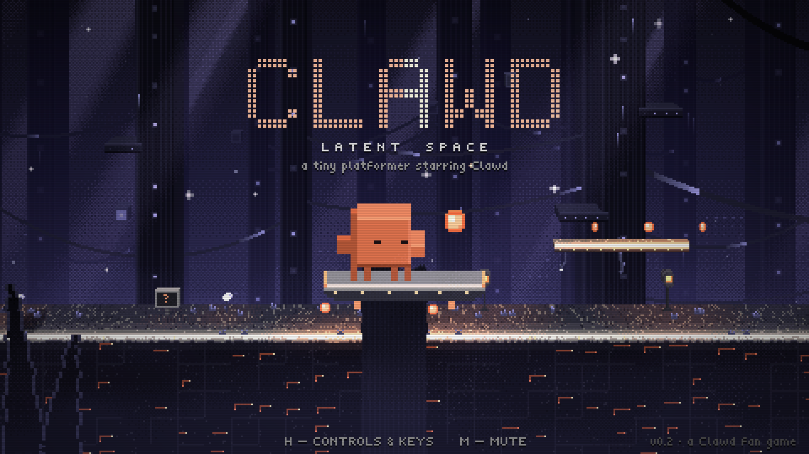

# CLAWD — Latent Space



A 2.5D platformer/shooter starring Clawd, made in **Godot 4.7.2** (GDScript). **World 1** is a platformer. At its
end Clawd finds the **Token Blaster**, and **World 2** turns into a shooter: aim with the mouse, fire tokens, and
buy better weapons and upgrades in the shop. The boss of World 2 is **Codex**, who drops the **Tool Call**: in
**World 3** Clawd hooks onto API endpoints and zips across chasms, sends sub-agents that replay his last moves to
hold pressure plates, and builds himself in the prompt tree.

After the Router (3-B) the **endgame** opens, an action RPG in the manner of Path of Exile: Clawd gains levels
from XP, enemies drop gear with random affixes, his hideout has a stash, a vendor and the **Map Device**, and maps
are generated levels with mods, a boss and more maps to find (being built: `godot/docs/endgame-plan.md`).

The game lives in [`godot/`](godot/); [`godot/README.md`](godot/README.md) is its detailed design doc (rendering,
levels, every system, checks, layout). It started as a port of a TypeScript browser game, which is kept on the
`ts-legacy` branch; the 2D Godot port is on `godot-2d-port`.

## Running

Open `godot/project.godot` in Godot 4.7.2 and press F5, or from `godot/`:

```bash
godot --path .                                   # play
godot --headless --script tools/check.gd         # every check, exits non-zero on failure
godot --headless --script tools/reach.gd         # every level's exit, sparks and sub-agents are reachable
godot --headless --script tools/reach.gd -- chunks   # every map chunk can be crossed
godot --headless --script tools/reach.gd -- maps     # generated maps T1-T16: the boss can be reached
```

## Controls

| Input | Action |
|---|---|
| ← → / A D | Move |
| Space / W / K | Jump (every jump is a full jump) |
| Hold jump in the air | Hover (the jet hurts enemies) |
| X / J · left mouse button | World 1: spin · World 2: shoot |
| C / L | Spin |
| Shift / F · right mouse button | World 3: Tool Call (hook to endpoints, zip there) |
| G · middle mouse button | World 3: send a sub-agent (replays your last 3 s, holds plates) |
| ↓ / S in the air | Ground pound (breaks purple "corrupted" blocks) |
| ↓ + Space | Drop through a platform |
| Mouse | World 2: aim (↑ / ↓ + X aims without a mouse) |
| 1–5 · Q R · mouse wheel | Switch weapon (not while a weapon item is equipped) |
| E | Pick up the item you stand by · use a hideout station |
| I | Inventory (with the stash on the map) |
| B · T · O (on the map) | Shop · prompt tree · hideout (after 3-B) |
| Esc / P · M · H | Pause · mute · controls |
| Pause → Keybindings | Rebind keys |

The pause menu also has the CRT filter and the crosshair's colour. Keyboard and mouse only.

## Content

**World 1 — Latent Space** (platformer)
- 1-1 Token Plains, 1-2 Gradient Caves (dark), 1-3 Context Window (rising void)
- 1-B The Hallucination: drops the Token Blaster, unlocking World 2

**World 2 — Benchmark Wars** (shooter)
- 2-1 Merge Conflict Mesa: turrets, drones, shield bots
- 2-2 GPU Forge: hot vents, ceiling turrets, 429 crushers, moving platforms
- 2-3 Prompt Injection Swamp: injectors (they split into bugs when destroyed), islands
- 2-4 The Diff Towers: a vertical climb under fire
- 2-B Codex: a monitor with two giant cursor hands, autocomplete walls, `{ }` volleys, "npm test" bugs and
  `rm -rf` beams, in 3 phases

**World 3 — Agent Mode** (hook, sub-agents, builds)
- 3-1 Endpoint Canopy: the Tool Call's tutorial, anchor chains over chasms, armoured parsers
- 3-2 Webhook Cliffs: a climb; webhooks (flying anchors), sub-agents, plates and gates
- 3-3 The Sandbox: everything breaks; Retry Loops spawn bugs until destroyed (a good place to farm)
- 3-4 Timeout Ravine: timeout anchors, a racing plate, two plates at once
- 3-B The Router: a firewall only the hook tears down, packets, loopback echoes and a timeout storm

**Weapons** (Context = heat; when it overflows the weapon has to cool down): Token Blaster (found), Context
Spreader, Stream Output, Attention Beam, Opus Cannon.

**Shop**: upgrades (Extra Heart, Bigger Model, Faster Inference, Longer Context, Jet Tuning, Token Magnet), tools
(Spark Radar, Fortune Haiku), consumables (Firewall, Double Tokens) and, once a weapon is found, the armory.

**Prompt tree** (world 3, T on the map): a passive tree like Path of Exile's, 137 nodes in eight sectors (tool
call, elements, offense, precision, movement and tokens, sustain, defence, sub-agents), with a point per character
level, one per world 3 spark and more for tokens; small nodes, notables such as Be concise. (faster, weaker shots),
Tool use. (sub-agents shoot) or Reflect. (the hook throws enemy shots back), and keystones such as Temperature 0.
(straight shots, no critical strikes) or Air-gapped. (immune to Corruption, less life). Refunds are free.

**Endgame** (`godot/docs/endgame-plan.md`; done: character level, items, inventory, hideout, maps T1-T16, orbs,
elements, the Atlas, the prompt tree for levels up to 100)
- Character level: XP from every enemy (less from ones far below Clawd), up to level 100; about 13 by the end of 3-B.
- Items drop everywhere: weapons (the five guns), context windows, chassis, actuators, treads, cores and plugins,
  normal / magic / rare with tiered affixes; E picks them up, I opens the inventory (equip, compare, stash).
- Hit points instead of hearts in the hideout and maps: life, armour, evasion, regeneration, resistances to
  Overheat, Latency, Voltage and Corruption, and ailments (burning, chilled, frozen, shocked) both ways.
- Currency orbs for crafting (Prompt Seed, Few-shot Example, Resample, Distillation, Context Reset, Temperature
  Spike, RLHF, Fine-tune), picked up on touch into a pouch: click an orb in the inventory, then an item.
- The hideout (O on the map after 3-B): the stash, a vendor (buys anything, sells a stock that changes after each
  cleared level), a terminal for the prompt tree, the Atlas's globe, a portal, and the Map Device.
- Maps: items with a tier and mods (more enemies, tougher enemies, less life ...) that raise item quantity and
  rarity; the device turns one into a generated level with six portals (a death costs one and some XP) and a boss
  at its end who drops more maps. T1-T5 are world 1's (THE OVERFITTER), T6-T10 world 2's (THE JAILBREAK), T11-T16
  world 3's (THE INFINITE LOOP), each in the look of one of that world's levels.
- The Atlas (the globe, or Tab in the prompt tree): a tier's boss beaten opens the next tier and gives an Atlas
  point, a world's first rare map one more; the points go into a tree of map bonuses (loot, maps, orbs, sustain).

Tokens collected in a level are added to your wallet when you finish it; every 300 tokens in a level give a heart.
Sparks are spent in the shop but still count as found on the map.

## Repository

| Path | What |
|---|---|
| `godot/` | The game (scenes, scripts, shaders, levels, tools); see `godot/README.md` |
| `godot/docs/` | Plans: `port-plan.md` (the finished port), `world3-plan.md`, `prompt-tree-plan.md`, `endgame-plan.md` (the ARPG endgame, in progress), `scenery-themes.md` |
| `godot/levels/` | The campaign's levels (`<id>.txt` maps, converted `.tscn`, `index.json`), the hideout, and `chunks/` for maps |
| `docs/` | Images for this README |
| `references/` | Reference images |
